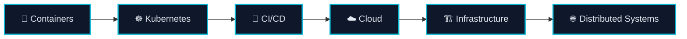

<!-- ═══════════════════════════ HEADER ═══════════════════════════ -->
<div align="center">


<a href="https://git.io/typing-svg">
  
</a>

<br/>

<!-- ─────────── Clickable contact badges ─────────── -->
<a href="https://www.linkedin.com/in/mohamedouijjane/"></a>
<a href="https://github.com/MohamedOuijjane"></a>
<a href="https://wa.me/212656706270"></a>
<a href="mailto:ouijjane22@gmail.com"></a>
<a href="https://wejan-lime.vercel.app"></a>

<br/><br/>


</div>

---

## 👋 About me

```yaml
name:        Mohamed Ouijjane
role:        Software Engineering student — Master IL (Excellence Program), Université Ibn Zohr
graduating:  2027
looking_for: End-of-studies internship (PFE) — 2027
focus:       [Backend (Java/Spring), Full-Stack (Next.js/React), Data Engineering, Cloud-Native]
languages:   [Arabic (native), French (B2), English (B2)]
```

- 🏢 **Software Engineering Intern @ OCP Group** (Human Capital Division) — built an HR decision-support platform end-to-end: Spring Boot 4 / Java 21 APIs, Next.js dashboards, Airflow ETL into a PostgreSQL data warehouse, Camunda 8 workflows, Docker + Kubernetes, CI/CD and full observability.
- ⚙️ Passionate about **distributed systems**, **cloud-native architecture** and turning manual processes into reliable software.
- 🤝 Open to collaborating on **open-source**, **backend platforms** and **full-stack applications**.

---

## 🧭 Engineering path

> What I'm building expertise in — from shipping containers to designing systems that scale.



| Layer | What I've actually used |
|---|---|
| 🐳 **Containers** | Docker, Docker Compose for multi-service stacks (Spring, FastAPI, Django, Postgres, Redis, RabbitMQ, MinIO) |
| ☸️ **Kubernetes** | Test deployments of a multi-service app (OCP internship) |
| 🔁 **CI/CD** | GitHub Actions, Jenkins — build, JUnit/Mockito/Testcontainers tests, deploy to test env |
| ☁️ **Cloud / Platform** | Vercel deployments, Keycloak (OAuth2/OIDC), MinIO object storage |
| 🏗️ **Infrastructure & Observability** | Prometheus, Grafana, OpenTelemetry, Loki |
| 🌐 **Distributed Systems** | Java RMI master/worker grid, REST/SOAP microservices, async messaging (RabbitMQ, Celery/Redis) |

---

## 🛠️ Tech stack

<div align="center">

**Languages**
<br/>
<a href="https://skillicons.dev"></a>

**Backend**
<br/>
<a href="https://skillicons.dev"></a>

**Frontend**
<br/>
<a href="https://skillicons.dev"></a>

**Data & Machine Learning**
<br/>
<a href="https://skillicons.dev"></a>
<br/>


**DevOps · Cloud-Native · Observability**
<br/>
<a href="https://skillicons.dev"></a>
<br/>


</div>

---

## 🚀 Featured work

> Five projects that best show how I build: distributed systems, ML in production, microservices and polished front-ends.

<table>
<tr>
<td width="50%" valign="top">

### 🌐 [CPU Grid — Distributed Monte Carlo](https://github.com/ZakariaHanani/distributed-cpu-montecarlo-traffic)
Distributed traffic-simulation grid: a **Java RMI** master splits Monte Carlo jobs into batches, dispatches them asynchronously to discovered workers and aggregates results.

**⚡ 3.55× speed-up on 4 worker nodes** · Spring Boot auth service (JWT, GitHub OAuth) · Next.js dashboard to launch jobs & monitor the cluster. Team project — top contributor.


</td>
<td width="50%" valign="top">

### 📈 [AI Trading Platform](https://github.com/MohamedOuijjane/ai-trading-platform)
Paper-trading platform powered by **LSTM** models predicting next-day moves from technical indicators (RSI, MACD, Bollinger…), with day-by-day backtesting.

**Django REST (JWT) + FastAPI inference · PostgreSQL · React dashboard · Docker Compose**


</td>
</tr>
<tr>
<td width="50%" valign="top">

### 🩺 [DermaScan AI — Skin Lesion Classification](https://github.com/Azepuo/skin-cancer-detection-projet)
CNN trained from scratch on **HAM10000** (10,015 images, 7 classes): validation accuracy raised from **71.7% → 98.7%** via oversampling, batch norm, L1L2 regularisation and LR scheduling.

**FastAPI backend · JWT auth · inference API · analysis history (MySQL) · React/TypeScript front-end** · Team project.


</td>
<td width="50%" valign="top">

### 🏗️ [BTP Chantiers — Microservices Platform](https://github.com/MohamedOuijjane/btp-chantiers)
Construction-site management platform built as **4 dockerised microservices** in 3 languages — Spring Boot (REST), Spring-WS (**SOAP**, contract-first WSDL), NestJS and FastAPI — behind an nginx API gateway. Master IL team project — project lead.


</td>
</tr>
<tr>
<td colspan="2" valign="top">

### ✨ [Personal Portfolio](https://github.com/MohamedOuijjane/MohamedOuijjanePortfolio) · [Live demo ↗](https://wejan-lime.vercel.app)
My personal site, built for **performance, SEO and a clean UI** — deployed on Vercel. The best place to see my projects, experience and contact info in one page.


</td>
</tr>
</table>

<details>
<summary><b>📂 More projects & labs</b></summary>
<br/>

| Project | Description | Stack |
|---|---|---|
| [**PlatformInscription**](https://github.com/MohamedOuijjane/PlatformInscription) | Registration platform for language exams: candidate & admin dashboards, payment tracking, PDF reports | PHP 8 · CodeIgniter 4 · MySQL |
| [**DevOps Lab**](https://github.com/MohamedOuijjane/devops-lab) | Flask app containerised with Docker and deployed on Kubernetes (Deployment + Service) | Python · Docker · Kubernetes |
| [**Jenkins Demo**](https://github.com/MohamedOuijjane/jenkins-demo) | Declarative Jenkins pipeline (build, test, run, deploy stages) | Jenkins |
| [**WordPress Project**](https://github.com/MohamedOuijjane/wordpress_project) | E-commerce website built with WooCommerce and Elementor | PHP · WordPress · WooCommerce |

</details>

---

## 💼 Experience

| | Role | Highlights |
|---|---|---|
| 🏭 **OCP Group** — Human Capital Division<br/><sub>Jun 2026 – Oct 2026 · Jorf Lasfar</sub> | Software Engineer Intern — Full-Stack & Data Engineering | Spring Boot 4 / Java 21 · Keycloak RBAC · Airflow ETL → PostgreSQL DWH · Next.js 16 dashboards · Camunda 8 · Docker/K8s · CI/CD · Prometheus/Grafana/OTel |
| 🥛 **COPAG**<br/><sub>Apr 2022 – Jul 2022 · Taroudant</sub> | Full-Stack Developer Intern | Generic Master Data Management platform (Angular, Node/Express, SQL Server) — data creation time cut from **days to < 5 min** |
| 🏛️ **Ministry of the Interior**<br/><sub>Jul 2021 – Aug 2021 · Taroudant</sub> | Web Development Intern | IT asset management web app (PHP, MySQL, Sass) |

---

## 📊 GitHub stats

<div align="center">

<!-- Cartes github-readme-stats masquées : instance publique indisponible. À réactiver avec votre propre instance Vercel.


-->


<!-- Activity graph masqué : instance publique indisponible. À réactiver avec votre propre instance Vercel.

-->

<!-- Contribution snake — generated by .github/workflows/snake.yml -->
<picture>
  <source media="(prefers-color-scheme: dark)" srcset="https://raw.githubusercontent.com/MohamedOuijjane/MohamedOuijjane/output/github-contribution-grid-snake-dark.svg"/>
  <source media="(prefers-color-scheme: light)" srcset="https://raw.githubusercontent.com/MohamedOuijjane/MohamedOuijjane/output/github-contribution-grid-snake.svg"/>
  
</picture>

</div>

---

## ☕ Support my work

<div align="center">

If my projects helped you or you just want to say thanks:

<a href="https://buymeacoffee.com/ouijjane"></a>

</div>

---

## 📡 Open channels

<div align="center">

**Hiring for a 2027 PFE internship, building something interesting, or just want to talk systems?**
<br/>
My inbox is open — I usually reply within 24 hours.

<br/>

| | Channel | Best for |
|:---:|---|---|
| <a href="https://www.linkedin.com/in/mohamedouijjane/"></a> | [**LinkedIn**](https://www.linkedin.com/in/mohamedouijjane/) | Internship & job opportunities |
| <a href="mailto:ouijjane22@gmail.com"></a> | [**ouijjane22@gmail.com**](mailto:ouijjane22@gmail.com) | Detailed proposals, CV requests |
| <a href="https://wa.me/212656706270"></a> | [**WhatsApp**](https://wa.me/212656706270) | Quick questions |
| <a href="https://github.com/MohamedOuijjane"></a> | [**GitHub**](https://github.com/MohamedOuijjane) | Code collaboration & issues |
| <a href="https://wejan-lime.vercel.app"></a> | [**Portfolio**](https://wejan-lime.vercel.app) | Everything in one place |

<br/>


</div>
